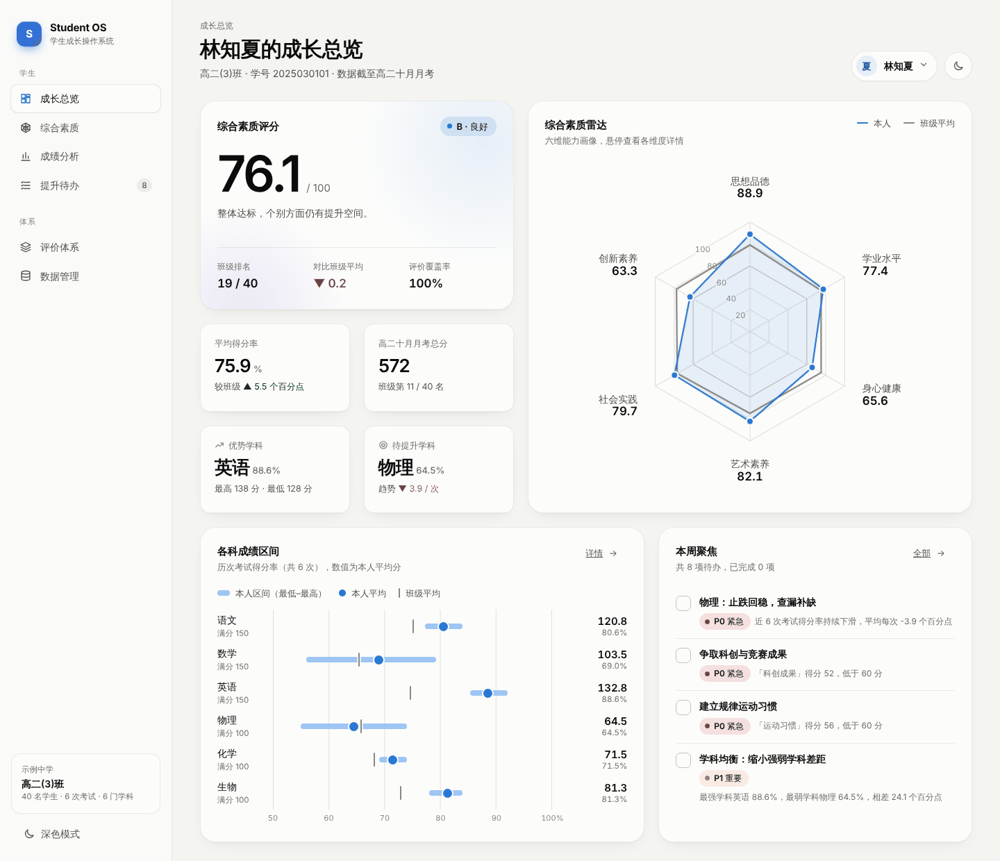
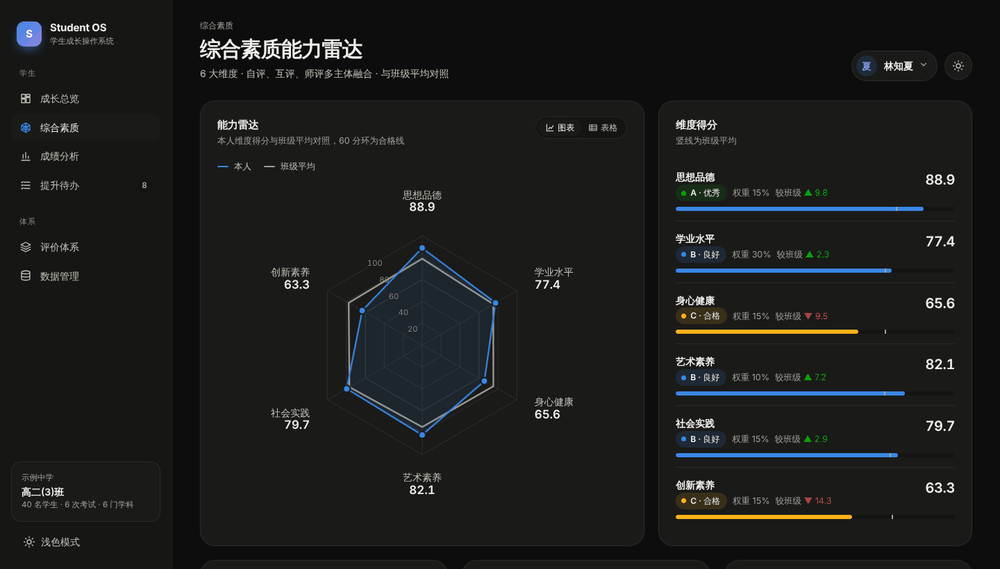
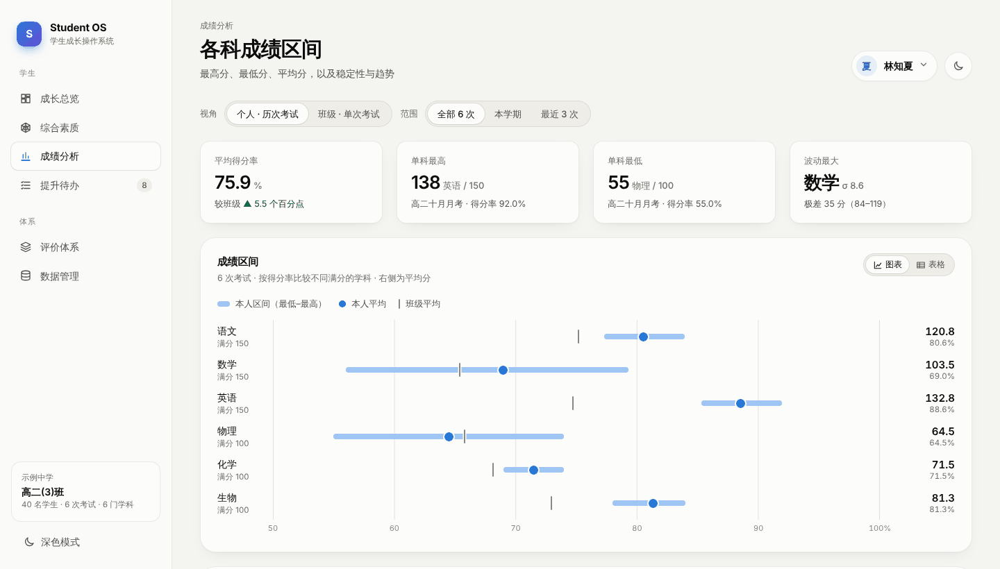

# Student OS · 学生成长操作系统

面向班级与学生的综合素质评价系统：用一套可配置的评价体系把考试成绩和日常表现汇总成**能力雷达**，统计**各科成绩区间**，并把薄弱项自动转化为**可执行的提升待办**。



## 功能

| 模块 | 内容 |
| --- | --- |
| **成长总览** | 综合素质评分与等级、班级排名、六维雷达、各科区间、本周聚焦待办 |
| **综合素质** | 六维能力雷达（本人 vs 班级平均）、维度得分、17 项二级指标与自评 / 互评 / 师评明细 |
| **成绩分析** | 各科**最高分、最低分、平均分**、极差、标准差、走势；支持「个人 · 历次考试」与「班级 · 单次考试」两种视角 |
| **提升待办** | 按 P0 / P1 / P2 自动生成的待办，每条含原因、行动清单、量化目标与时限；可勾选完成、添加自定义待办 |
| **评价体系** | 维度权重、指标体系、评价主体、等级标准、计算模型、待办规则与评价流程 |
| **账号与数据** | 用户名密码注册登录、修改密码、删除账号；JSON 导入（含校验与错误提示）/ 导出、数据模板、恢复演示数据 |

其他：浅色 / 深色模式（默认跟随系统）、移动端底部导航、所有图表均可切换为表格视图、支持键盘操作。

| 综合素质（深色） | 成绩区间 |
| --- | --- |
|  |  |

## 评价体系

六个一级维度依据教育部普通高中综合素质评价的五方面，并按《中国学生发展核心素养》补充「创新素养」：

| 维度 | 权重 | 二级指标 |
| --- | --- | --- |
| 思想品德 | 15% | 理想信念与公民素养 · 诚信守纪 · 责任担当 |
| 学业水平 | 30% | 学科成绩（自动）· 学科均衡（自动）· 学习习惯 |
| 身心健康 | 15% | 体质健康 · 运动习惯 · 心理素质 |
| 艺术素养 | 10% | 审美与艺术修养 · 艺术实践 |
| 社会实践 | 15% | 劳动实践 · 志愿服务 · 社团与集体活动 |
| 创新素养 | 15% | 研究性学习 · 科创成果 · 批判与创新思维 |

- 多主体评价：自评 20%、互评 20%、师评 60%
- 等级：A 优秀 ≥ 85，B 良好 75–84.9，C 合格 60–74.9，D 待提升 < 60
- 计算：指标 → 维度 → 综合分逐级加权，缺失数据不计入并按剩余权重归一

完整说明（含计算公式、成绩统计口径与待办生成规则）见 [docs/evaluation-framework.md](docs/evaluation-framework.md)。

## 快速开始

需要 Node.js 20.19 及以上。

```bash
npm ci
npm run dev       # 本地开发 http://localhost:5173
npm test          # 单元测试
npm run build     # 类型检查 + 生产构建，产物在 dist/
```

构建产物是纯静态文件（使用 hash 路由与相对路径），可以直接部署到 GitHub Pages、Nginx 或任意静态托管。

`npm run build:artifact` 会生成可发布为 claude.ai Artifact 的单文件页面 `dist-artifact/student-os.html`：React 18.3.1 以 UMD 形式从 cdnjs 加载，应用代码与样式内联；在 Artifact 中导出数据通过 `downloads` 能力完成，查看者确认后保存。

## 使用自己的数据

首次打开需要注册账号。每个新账号自带一份演示数据（高二(3)班，40 名学生、6 次考试、6 门学科，固定随机种子生成）。在「账号与数据」页可以下载模板、导入本班数据：

```jsonc
{
  "version": 1,
  "school": "示例中学",
  "className": "高二(3)班",
  "subjects": [{ "id": "math", "name": "数学", "fullMark": 150 }],
  "exams": [{ "id": "g2-oct", "name": "高二十月月考", "date": "2026-10-17", "term": "2026–2027 第一学期" }],
  "students": [{
    "id": "2025030101",
    "name": "林知夏",
    "indicators": {
      "health.fitness": 68,                                     // 写实记录：0–100
      "moral.integrity": { "self": 92, "peer": 90, "teacher": 93 } // 多主体评价
    }
  }],
  "scores": [{ "studentId": "2025030101", "examId": "g2-oct", "subjectId": "math", "score": 97 }]
}
```

- 指标 id 见 [评价体系文档](docs/evaluation-framework.md) 或 `src/core/framework.ts`；学科成绩与学科均衡由成绩自动计算，无需填写
- 导入时会校验引用关系与分值范围，并一次列出所有问题
- 数据与待办完成状态按账号保存在当前浏览器的 localStorage 中，不会上传到任何服务器

## 账号与登录

- 用户名 2–20 位（中文、字母、数字或下划线，不区分大小写）；密码 8–64 位，需同时包含字母和数字
- 密码经 PBKDF2-SHA256（60 万次迭代、16 字节随机盐）派生后保存，不保存明文；连续 5 次密码错误锁定 30 秒
- 每个账号有独立的工作区：班级数据、当前学生与待办进度互不影响
- 「保持登录 30 天」关闭时，登录状态只在当前标签页有效
- 首个注册的账号会继承登录功能上线前保存在本机的数据

账号保存在当前浏览器中：换设备或清除浏览器数据后需要重新注册，忘记密码也无法找回。它用来区分同一台设备上的不同使用者、隔离各自的数据，不能替代服务端鉴权，不适合保护敏感信息。需要跨设备登录或更强的安全性时，应增加后端服务。

## 项目结构

```text
src/
├── core/                    # 纯函数领域层（无 UI 依赖，全部有单元测试）
│   ├── framework.ts         # 评价体系配置：维度、指标、权重、主体、等级、流程
│   ├── evaluation.ts        # 指标 → 维度 → 综合分计算、班级均值与排名
│   ├── scoreStats.ts        # 成绩区间统计：最高 / 最低 / 平均 / 极差 / 标准差 / 趋势 / 排名
│   ├── recommendations.ts   # 提升待办规则引擎
│   ├── dataset.ts           # 导入数据校验
│   └── auth.ts              # 本地账号：用户名密码校验、PBKDF2 密码派生与验证
├── data/demo.ts             # 演示数据生成
├── state/                   # 全局状态、派生模型、路由与主题
├── components/              # 雷达图、成绩区间图、走势线等图表与基础组件
└── views/                   # 登录页与六个功能页
```

调整评价体系只需修改 `src/core/framework.ts`（维度、指标、权重、等级）与 `src/core/recommendations.ts` 中的 `THRESHOLDS`（待办阈值），界面会随之更新。

## 技术栈

React 19 · TypeScript · Vite · Vitest。图表为手写 SVG / CSS，无第三方图表库；配色使用经过色觉障碍校验的单一强调色（本人）+ 灰色（班级参照），等级与优先级的状态色始终配合文字标签。
