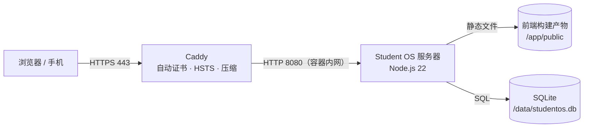
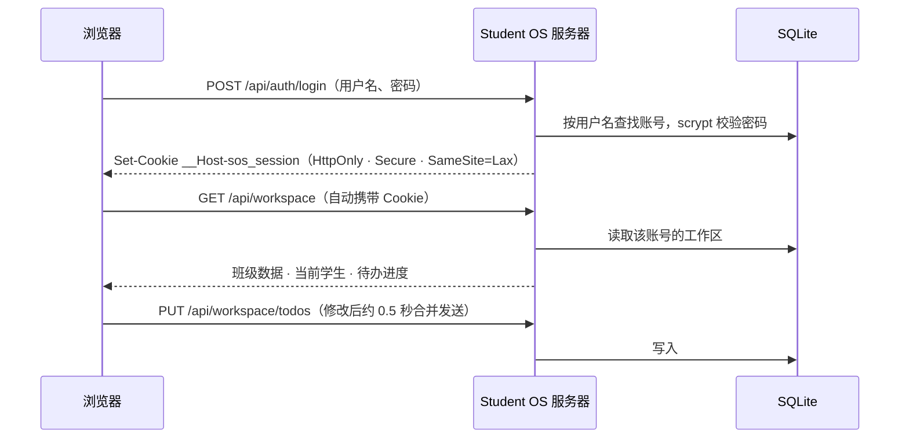
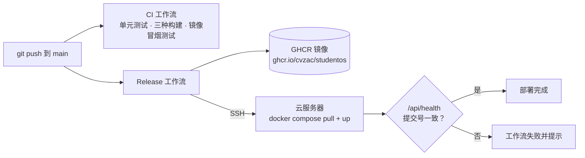
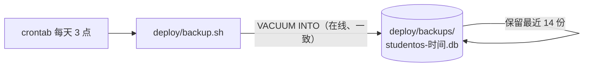

# 云端部署与链路说明

云端版本把账号与数据保存在服务器上，可以在任意设备登录。它由一个 Docker 镜像（前端 + API 服务器 + SQLite）和一个 Caddy 反向代理（自动 HTTPS）组成，适合部署在任意一台云服务器上：阿里云 ECS、腾讯云 CVM、AWS Lightsail / EC2、华为云等。

## 1. 访问链路



| 地址 | 用途 |
| --- | --- |
| `https://你的域名/` | Student OS 网页（登录、注册、全部功能） |
| `https://你的域名/api/health` | 健康检查：服务状态、数据库状态、版本号与提交号 |
| `https://你的域名/api/...` | 接口，见第 8 节 |

只有 Caddy 对外开放 80/443 端口；应用容器只在 Docker 内网监听 8080。

## 2. 登录与数据链路



- 密码用 scrypt（N=2^15、r=8、p=1，16 字节随机盐）派生后保存，数据库里没有明文密码
- 会话令牌是 32 字节随机数，数据库只保存它的 SHA-256 摘要；浏览器端放在 HttpOnly Cookie 中，网页脚本读不到
- 勾选「保持登录 30 天」时 Cookie 有效 30 天，否则关闭浏览器即失效（服务端最长 1 天）
- 修改密码后，该账号在其他设备上的登录全部失效
- 保存失败（如网络中断）时侧边栏显示「保存失败，点此重试」，修改不会丢失

## 3. 部署链路



| 工作流 | 触发 | 做什么 |
| --- | --- | --- |
| `.github/workflows/ci.yml` | 推送到 main、每个 PR | 测试；构建静态版、云端版、Artifact 版；构建镜像并请求 `/api/health` |
| `.github/workflows/release.yml` | 推送到 main、手动运行 | 构建镜像推送到 GHCR（标签 `latest` 与提交号）；配置了服务器后自动 SSH 部署并核对线上提交号 |

## 4. 备份链路



## 5. 首次部署（约 15 分钟）

**准备**

1. 一台云服务器：Ubuntu 22.04 / 24.04，1 核 1–2 GB 内存即可
2. 安全组 / 防火墙开放 22、80、443 端口（443 同时开放 UDP 以启用 HTTP/3）
3. 一个域名，添加 A 记录指向服务器公网 IP

> 中国大陆地域的服务器需要先完成 ICP 备案，域名才能通过 80/443 端口访问；香港及海外地域无需备案。

**在服务器上执行**

```bash
# 安装 Docker（国内服务器可改用云厂商提供的 Docker 镜像源）
curl -fsSL https://get.docker.com | sh

# 获取代码（私有仓库需配置部署密钥或使用个人访问令牌）
git clone https://github.com/CVZac/studentOS.git /opt/studentos
cd /opt/studentos/deploy

# 配置域名
cp .env.example .env
nano .env            # 把 DOMAIN 改成你的域名

# 构建并启动
docker compose up -d --build

# 检查
docker compose ps
curl https://你的域名/api/health
```

首次访问时 Caddy 会自动申请 Let's Encrypt 证书，通常在一分钟内完成。

## 6. 配置自动部署（可选）

推送到 main 后自动更新服务器：

1. 在服务器上生成部署密钥，并允许它登录：

   ```bash
   ssh-keygen -t ed25519 -f ~/.ssh/studentos_deploy -N ''
   cat ~/.ssh/studentos_deploy.pub >> ~/.ssh/authorized_keys
   cat ~/.ssh/studentos_deploy      # 复制私钥内容，下一步使用
   ```

2. 在 GitHub 仓库 Settings → Secrets and variables → Actions 中添加：

   | 类型 | 名称 | 值 |
   | --- | --- | --- |
   | Secret | `DEPLOY_SSH_KEY` | 上一步的私钥内容 |
   | Variable | `DEPLOY_HOST` | 服务器公网 IP 或域名 |
   | Variable | `DEPLOY_USER` | SSH 用户，默认 `root` |
   | Variable | `DEPLOY_PATH` | 代码目录，默认 `/opt/studentos` |
   | Variable | `DEPLOY_URL` | `https://你的域名`，用于部署后的健康检查 |

3. 在服务器的 `deploy/.env` 中加入 `STUDENTOS_IMAGE=ghcr.io/cvzac/studentos:latest`，让手动重启时也使用 CI 构建的镜像

未配置 `DEPLOY_HOST` 时，Release 工作流只构建并推送镜像，不会部署。

## 7. 日常运维

| 操作 | 命令（在 `/opt/studentos/deploy` 下执行） |
| --- | --- |
| 查看状态 | `docker compose ps` |
| 查看日志 | `docker compose logs -f app` |
| 手动更新 | `git pull && docker compose up -d --build` |
| 回滚到某个版本 | `STUDENTOS_IMAGE=ghcr.io/cvzac/studentos:<提交号> docker compose up -d --no-build` |
| 立即备份 | `sh backup.sh` |
| 每天自动备份 | `crontab -e` 加入 `0 3 * * * sh /opt/studentos/deploy/backup.sh` |

**从备份恢复**

```bash
docker compose stop app
docker compose cp backups/studentos-20261105-030000.db app:/data/studentos.db
# 清除旧的预写日志，并把文件归还给容器内的 node 用户（docker cp 会写成 root 所有）
docker compose run --rm --no-deps --user root --entrypoint sh app \
  -c 'rm -f /data/studentos.db-wal /data/studentos.db-shm && chown node:node /data/studentos.db'
docker compose start app
```

## 8. 接口

所有修改类请求需使用 `Content-Type: application/json`；跨站来源的请求会被拒绝。

| 方法 | 路径 | 说明 |
| --- | --- | --- |
| GET | `/api/health` | 健康检查 |
| POST | `/api/auth/register` | 注册并登录：`{ username, password, remember }` |
| POST | `/api/auth/login` | 登录：`{ username, password, remember }`；连续 5 次失败锁定 30 秒 |
| POST | `/api/auth/logout` | 退出登录 |
| GET | `/api/auth/me` | 当前账号，未登录时 `account` 为 `null` |
| POST | `/api/auth/password` | 修改密码：`{ current, next }` |
| DELETE | `/api/auth/account` | 删除账号及其数据：`{ password }` |
| GET | `/api/workspace` | 读取工作区：班级数据、当前学生、待办进度 |
| PUT | `/api/workspace/dataset` | 保存班级数据（服务端校验）；`{ dataset: null }` 恢复演示数据 |
| PUT | `/api/workspace/student` | 保存当前学生：`{ studentId }` |
| PUT | `/api/workspace/todos` | 保存待办进度：`{ todos }` |

## 9. 服务器环境变量

| 变量 | 默认值 | 说明 |
| --- | --- | --- |
| `PORT` | `8080` | 监听端口 |
| `HOST` | `0.0.0.0` | 监听地址 |
| `DATA_DIR` | `./data`（镜像中为 `/data`） | SQLite 数据库所在目录 |
| `PUBLIC_URL` | 空 | 对外地址；为 https 时启用 Secure Cookie，并只接受该来源的修改请求 |
| `TRUST_PROXY` | 空 | 设为 `1` 时从 `X-Forwarded-For` 读取客户端 IP、未配置 `PUBLIC_URL` 时按 `X-Forwarded-Host` 校验来源（位于反向代理之后时需要） |
| `STATIC_DIR` | 服务器文件旁的 `public/` | 前端构建目录 |
| `GIT_SHA` | 镜像构建时写入 | 健康检查中返回的提交号 |

## 10. 本地运行云端版

```bash
npm run build:cloud   # 生成 dist-cloud/（server.js + public/）
npm start             # http://localhost:8080
```

开发时可以同时运行 `npm start` 与 `npm run dev:cloud`，在 http://localhost:5173 获得热更新，`/api` 请求会转发到 8080 端口。

## 11. 安全设计与限制

- 防跨站请求伪造：SameSite=Lax Cookie + 只接受 JSON 请求体 + 校验 Origin
- 限流：同一用户名连续 5 次密码错误锁定 30 秒；同一 IP 每 10 分钟最多 30 次登录 / 注册请求
- 用户不存在时同样执行一次密码哈希，避免通过响应时间探测用户名
- 响应头：内容安全策略（只允许同源脚本）、`X-Frame-Options: DENY`、`nosniff`；Caddy 追加 HSTS
- 容器以非 root 用户运行，数据只写入 `/data` 卷
- SQLite 适合单台服务器（数千名用户以内）；需要多台服务器横向扩展时应换成 PostgreSQL
- 目前没有邮箱找回密码；忘记密码的用户需要重新注册
